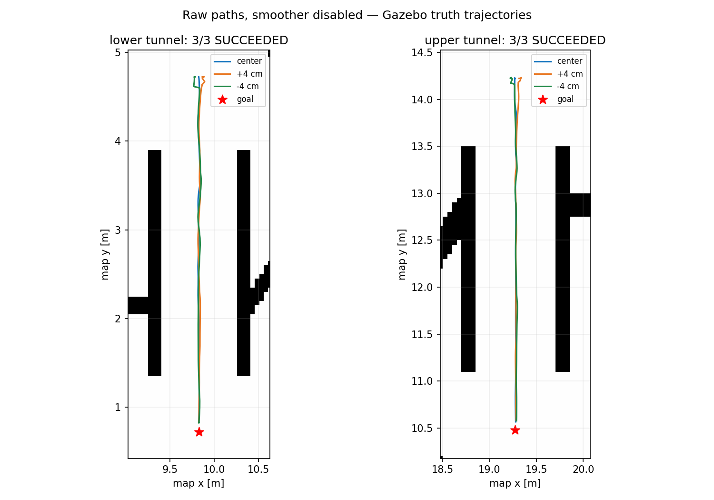

# 无 smoother 穿洞验证（2026-10-24）

> 本报告使用原 rmuc_2026.pgm、原点 [0, 0, 0]。用户要求继续使用这份原图，禁止重制 PGM。调整 YAML 原点后须重新验证，不能直接沿用这 6 次结果；这份历史报告不包含红圈通道。当前车辆调整后的五洞结果见 [新报告](no_smoother_vehicle_tunnels.md)。

当前 rmuc_2026 仿真默认关闭 path_smoother。修改包括直线窄道横向偏差调节、按距离预瞄、坡道间有界速度预测、场边平面定位校正，以及区分运动时间与输入接收时间。机器人半径 0.30 m、硬安全距离 0.33 m 和碰撞保护保留。

最终版本从上下洞口分别进行 3 次闭环测试：中心、横向 +4 cm 和 −4 cm 起步。6 次均实际穿槽并报告 SUCCEEDED，无执行中断、重新规划或恢复倒退。最大终点误差 0.107 m，槽内最大横向偏差 0.023 m，PGM 最小中心净空 0.40 m。安装后的 ROS 包入口额外冒烟测试也通过。

传感器断流测试在行进指令期间冻结雷达/IMU 桥接，独立时钟继续运行；0.8 秒后底盘命令全部为零。控制器 7 项、恢复 13 项和定位配准 1 项回归用例通过，相关 21 个功能包完整构建成功。

## 配置与边界

验证并采用的 Gazebo 默认档为 10 Hz、720×32 雷达。原 100 Hz、1875×32 档在当前 CPU 软件渲染环境仍存在定位漂移和保护停车，未计入成功验证。上述穿越从洞口附近起步，不是从默认出生点出发的任意长路径保证。

landmark_alignment 依赖当前场地可见的高大平面围墙，以及已标定、静止的初始位姿。它从雷达学习固定地标，不读取 Gazebo 真值；真值仅供验收。不要同时启动旧 modify_map_to_odom 广播器。其他地图或实车需要适配全局定位，不能直接外推本次结论。

结构化结果见 [结果 JSON](no_smoother_tunnel_results.json)。当前工作区的完整日志、逐帧轨迹和复现脚本位于 `/workspace/tunnel-test`，入口为该目录的 README.md。两份原 PGM/YAML 哈希保持不变。
