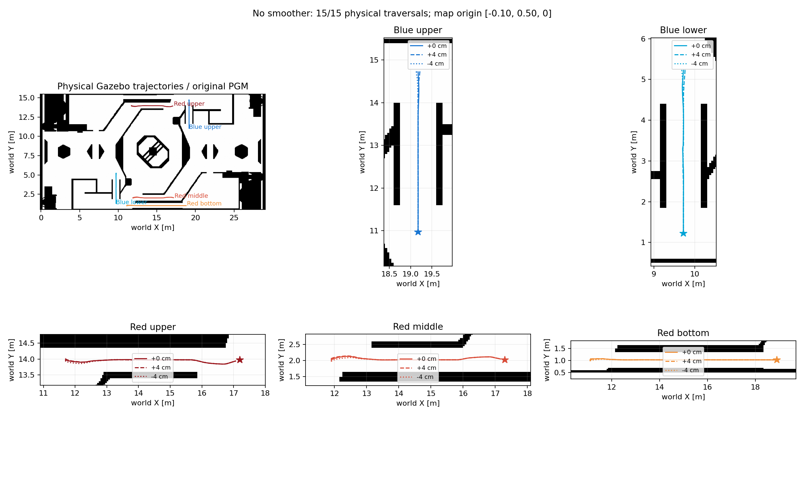

# 老图、原场地、无 smoother 的五处隧道验证

本轮使用 movoQAQ/originsim 的 `nav` 与 `gazebo` 分支，保留原 PGM/PCD 和现有 Gazebo 场地。车辆物理参数与导航算法单独修改，smoother 关闭。运行入口是新增的 `bringup/no_smoother_tunnels.launch.py`，采用轮速、IMU 与原始雷达围墙约束融合；原 Point-LIO 入口仍保留，二者不要同时启动。

15/15 次通过，全部实际覆盖洞内全段并停稳至少 3 秒。最大终点误差 **0.1413 m**，洞内最大横向偏差 **0.0198 m**，最大车体倾角 **5.62°**。

| 通道 | 通过 | 最大终点误差 | 执行中断后自动恢复 |
| --- | ---: | ---: | ---: |
| 蓝色上方 | 3/3 | 0.0980 m | 0 次 |
| 蓝色下方 | 3/3 | 0.0823 m | 0 次 |
| 红色上方 | 3/3 | 0.1411 m | 5 次 |
| 红色中间 | 3/3 | 0.1412 m | 3 次 |
| 红色最下方 | 3/3 | 0.0928 m | 0 次 |

上方和中间红洞共 8 次里程计超时保护短停，均自动重新规划后完成；因此结果不等于无中断通行。跨落差时记录到的最大瞬时定位 XY 偏差约 **0.592 m**，洞内实际横向轨迹仍保持在中心线 2 cm 内。测试未发生翻车，也未使用人工推动车体或场地补丁。

真实传感器桥接断流测试通过：冻结雷达、IMU、轮速桥接后，里程计最后输出在故障后约 **0.085 秒**；0.8 秒后的 **25 条**底盘指令全部为零，独立仿真时钟继续推进约 **1.926 秒**。联合构建 **22 个包**成功，相关回归 **36 项**通过。完整重编译后的安装入口再次从底部红洞横向 −4 cm 起步，通过穿洞并停稳。

完整哈希、断流结果及源码快照见 [约束与验证记录](no_smoother_vehicle_validation.json)。



## 验收方法

每处从中心、横向 +4 cm、横向 −4 cm 三个起点启动全新仿真。起点和目标随原图 YAML 的平移一起调整。蓝色通道从上向下，三个红色通道从左向右；本轮不包含反向通行或从默认出生点出发的长路径。

同时满足以下条件才记为通过：

- Gazebo 实际轨迹覆盖洞内至少 95% 的 0.1 m 分段，并经过洞口两端外至少 0.3 m；绕行不算通过。
- 实际终点 XY 误差小于 0.30 m，执行器报告 `SUCCEEDED`。
- 底盘指令、实际线速度和实际角速度均小于 0.05，连续保持至少 3 秒仿真时间；验收真值还须保持新鲜。
- 从运行节点读取确认 `path_smoother.enabled=false`，从实际加载的地图文件确认老 PGM 的 SHA256 与原始记录一致。

每次的结果、日志、中断次数、定位误差、最大车体倾角和原始文件哈希见 [结构化结果](no_smoother_vehicle_results.json)。原始逐帧数据和复测脚本位于 `/workspace/tunnel-test/vehicle-physics/v24-suite/` 与 `/workspace/tunnel-test/vehicle-v24-suite.sh`。

## 修改内容

车辆采用 `tunnel_vehicle_physics.json`：降低重心，给参考链接显式设置小质量，调整上部总成质量和主惯量，纵向轴距从 0.50 m 调为 0.66 m，车体接触摩擦为 0.15，增加车体系角阻尼 `[500,1500,2]` N·m·s/rad。轮半径、轮距、轮宽、车身碰撞盒形状及传感器安装不变；轴距修改成对作用于安装位置与运动学参数。完整参数与被动阻尼能量约束见 gazebo 检出的 `docs/vehicle_tunnel_physics.md`。

原车辆在最下方红圈处遇到约 0.55 m 下落及后续 0.20 m 台阶，曾实体翻转。加长轴距、降低重心及被动角阻尼改善这处跨槽姿态。蓝色下方洞口有凸出的立柱，较长车辆横着经过会被卡住；新的行进航向控制先对准车身纵轴，再进入通道，前进和倒退共享同一车身轴向。

控制器保留原始栅格路径，使用空间预瞄处理小折点，窄道直接调节有符号横向误差。验证配置为 20 Hz、10 步预测、直线速度上限 1 m/s、横向误差增益 4、横向修正上限 0.15 m/s。QP、延迟段、候选预瞄和实际输出的碰撞扫掠仍保留。机器人地图半径 0.30 m，MapServer 物理余量 0.01 m、栅格余量 0.02 m；控制器额外余量 0.01 m。

新的定位后端正确处理 IMU 安装旋转与杆臂，以水平轮轴投影计算轮胎滚动方向。雷达从静止扫描中学习高围墙；常规校正要求两个轴向都有长墙段支持。打滑后重新定位要求至少三面墙、两个轴向、墙间约束一致，创新量不超过 1 m；单帧位置修正不超过 0.15 m，未恢复前抑制里程计输出。0.4 秒雷达位移窗口用于估计实际速度，轮胎空转不会直接被当作真实行进速度。运行节点仅订阅轮速、IMU、雷达，Gazebo `/Odometry` 仅由独立验收程序使用。

## 保留项与使用边界

老 `rmuc_2026.pgm` SHA256 为 `effa57cda55399b668fd17422e90248f405565d3883e29db6fdbd26400460e17`。PCD SHA256 为 `4180f074d4d7916d5eaa66ef9f9a02f83223c9c053bd2582666f24dc1c58343a`。YAML 仅平移原点到 `[-0.10,0.50,0]`，分辨率、旋转、阈值不变；[配准依据](original_map_alignment.md)描述残余几何差异。

场地主模型、主碰撞 STL、减速带模型及 STL、world SDF 共 5 个资源哈希均与原始记录一致，重力、接触面、场地摩擦等物理属性未修改。下降坡提案保存在仓库之外，未应用。验证记录为 `/workspace/tunnel-test/vehicle-only-validation.json`。

验证环境是 ROS 2 Jazzy / Gazebo Harmonic、CPU 软件渲染、10 Hz 的 720×32 雷达、静态 PGM 障碍模式。高负载 100 Hz / 1875×32 档未通过稳定性验证。新的定位后端要求静止、平地、车身 X 轴与地图 X 轴一致的标定起步，以及可见的高大轴向围墙；只估计平面位置，不估计车体高度。它和本次较强的仿真角阻尼都需要针对其他场景或实车重新验证。

## 运行与复现

依赖已安装在专用 `originsim-test` 容器，两个分支通过 `/workspace/tunnel-test/ws` 联合构建。依赖版本和原始分支提交分别记录在 `dependency-versions.txt`、`source-manifest.json`。源码修改尚未提交或推送。

在两个终端分别启动仿真与导航；以下导航标定必须与车辆出生位置一致。不要同时启动旧 `startup.launch.py` 或额外的 `nav_executor`。

```bash
source /opt/ros/jazzy/setup.bash
source /workspace/tunnel-test/ws/install/setup.bash
ros2 launch rmu_gazebo_simulator tunnel_sim.launch.py \
  gz_world_path:=$(ros2 pkg prefix rmu_gazebo_simulator)/share/rmu_gazebo_simulator/config/tunnel_red_bottom_spawn.yaml
```

```bash
source /opt/ros/jazzy/setup.bash
source /workspace/tunnel-test/ws/install/setup.bash
# 例：最下方红洞中心起步
ros2 launch bringup no_smoother_tunnels.launch.py \
  initial_x:=11.1 initial_y:=1.025 initial_z:=0.4758
```

| 通道 | 中心起点 XY | 目标 XY | 起始 chassis 高度 |
| --- | --- | --- | --- |
| 蓝色上方 | [19.175,14.725] | [19.175,10.975] | 0.4758 m |
| 蓝色下方 | [9.725,5.225] | [9.725,1.225] | 0.2758 m |
| 红色上方 | [11.7,13.975] | [17.2,13.975] | 0.2758 m |
| 红色中间 | [11.9,2.025] | [17.3,2.025] | 0.4758 m |
| 红色最下方 | [11.1,1.025] | [18.9,1.025] | 0.4758 m |

整体复测：`bash /workspace/tunnel-test/vehicle-v24-suite.sh`。每次会重启并在结束后停止专用测试容器，日志与逐帧验收数据保存在相应 trial 目录。
