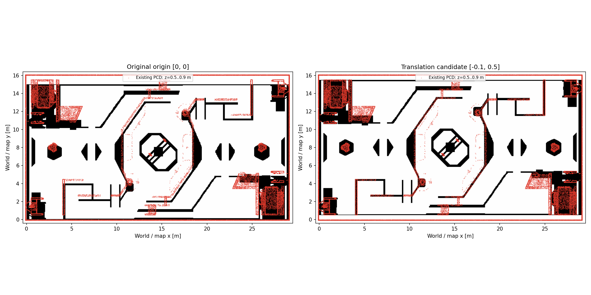

# 原 PGM 与现有 PCD 的平移配准

按用户最新约束，默认导航继续使用 `src/bringup/map/rmuc_2026.pgm`，禁止重制或修改像素。仅将同名 YAML 的 `origin` 从 `[0, 0, 0]` 调整为 `[-0.10, 0.50, 0]`；分辨率仍为 0.05 m，旋转仍为 0，阈值未变。启动文件与测试启动文件均恢复选择这份老图。

此前生成的替代地图、生成器及其说明已移到源码仓库之外的 `/workspace/tunnel-test/retired-generated-map/`，不再用于导航。

## 原点依据

读取现有 `rmuc_2026.pcd` 的世界坐标点，只对原图朝向自由区的障碍边界拟合 XY 平移。使用场内 x∈(1,28)、y∈(0.5,14.5) 的边界点，避开尺寸不一致的外围围墙；拟合损失对大于 0.6 m 的距离截断，降低不对应结构的影响。此工具只输出诊断 PNG/JSON，不输出 PGM。

在 z=0.5–0.9 m 的 PCD 高度带内，拟合平移约为 `[-0.079, 0.516]` m，按原栅格分辨率取 `[-0.10, 0.50]` m。最近表面距离中位数由 0.426 m 降至 0.237 m，10 cm 内边界比例由 24.4% 提高至 41.8%。其他两个高度带的拟合 Y 也约为 0.52 m。指标描述最近表面配准效果，不代表所有边界已有正确的一一对应。

## 不变项及边界

- 原 PGM SHA256：`effa57cda55399b668fd17422e90248f405565d3883e29db6fdbd26400460e17`，与开始测试时的记录一致。
- PCD SHA256：`4180f074d4d7916d5eaa66ef9f9a02f83223c9c053bd2582666f24dc1c58343a`，未重采样或改写。
- 机器人半径仍为 0.30 m，地图分辨率和 Gazebo 碰撞网格不变；MapServer 的 0.01 m 物理余量和 0.02 m 栅格余量不变。控制器额外余量从 0.02 m 调为与 MapServer 一致的 0.01 m，并未关闭扫掠碰撞检查；smoother 保持关闭。
- 原图与 PCD 存在局部形状和外围尺寸差异，单一平移无法完全消除。此前在原点 `[0,0,0]` 下对红圈位置的冲突判断不充分，须以平移后的测试为准。
- 用户原图中圈选的位置用像素保持对应：目标点和验收通道范围统一加上新原点。仿真真值仅用于验收，不作为运行中的定位输入。
- [原 6 次蓝圈通道结果](no_smoother_tunnels.md)使用原点 `[0,0,0]`，不能算作新原点下的回归结果。车辆物理参数调整后的五处通道重复验证见 [当前报告](no_smoother_vehicle_tunnels.md)。

数值与各高度带敏感性见 [配准结果](original_map_alignment.json)，可复现脚本为 `/workspace/tunnel-test/align-original-map.py`。

原车辆在底部红圈曾实测实体翻车。用户选择保持现有 Gazebo，不应用下降坡提案，随后允许仅调整车体物理属性。原因与原场景证据见 [底部通道失败说明](original_map_bottom_failure.md)。
