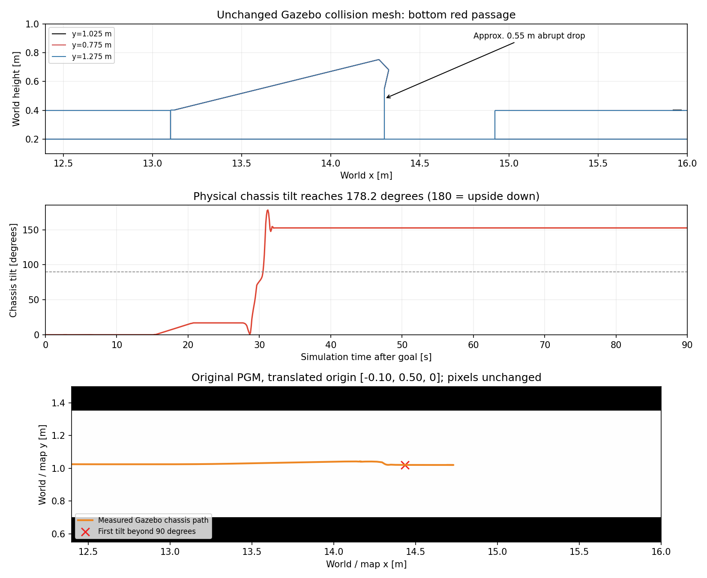

# 原车辆在底部红圈处的失败原因

这是车辆物理参数调整前的历史诊断。原 Gazebo 碰撞网格包含从约 0.75 m 到 0.20 m 的落差、短沟槽及后续约 0.20 m 上台阶。原车辆实测出现最大约 178.2° 的车体倾角，属于实体翻车，不能计为导航通过。

用户选择保持现有 Gazebo，因此新增下降坡提案未应用。随后用户允许调整车体物理属性，新的方案只修改车辆重心、质量分配、惯量、轴距、摩擦和被动角阻尼，配合定位与控制修正。当前验证见 [车辆调整后的五洞报告](no_smoother_vehicle_tunnels.md)。

老 PGM 像素保持原样，YAML 原点为 `[-0.10,0.50,0]`。场地模型及物理属性保持原样；历史失败不能用修改场地掩盖，历史结果也不替代新车辆的重复验证。
