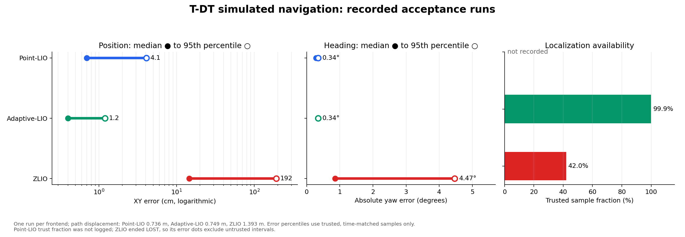
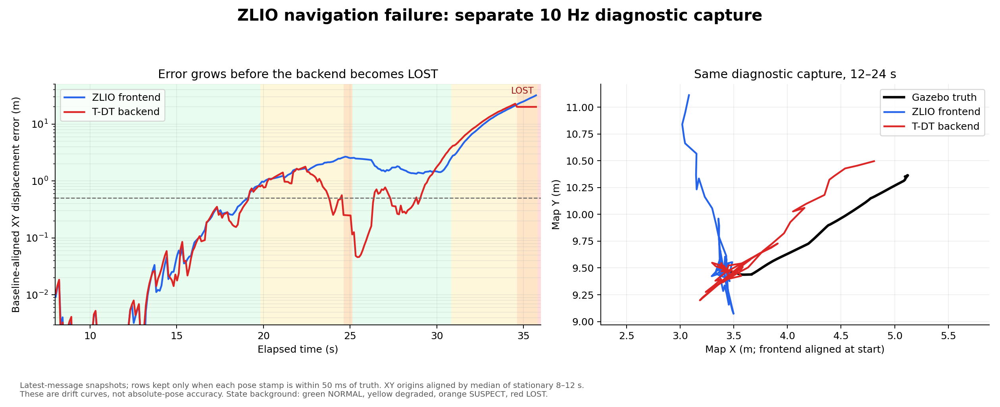

# T-DT 仿真定位精度：统计图与轨迹诊断

此报告汇总 `nav` 分支接入 T-DT 后端后的三种前端验收：Point-LIO、Adaptive-LIO、ZLIO。数据来自同一 Gazebo 场景和 PCD 先验图，但各次路径、时长及前端参数并非完全相同。图中的数值是**已完成的单次仿真验收**，不能当作重复实验的置信区间。

## 导航验收对比

| 前端 | 时长 | 车体位移 | 可信同步样本 | XY 误差中位数 / P95 | 航向误差中位数 / P95 | 可信比例 | 结束状态 |
| --- | ---: | ---: | ---: | ---: | ---: | ---: | --- |
| Point-LIO | 45 s | 0.736 m | 1,935 | 0.7 / 4.1 cm | 0.29° / 0.34° | 未记录 | 完成路径，期间有一次 TF 中断 |
| Adaptive-LIO | 70 s | 0.749 m | 12,427 | 0.4 / 1.2 cm | 0.34° / 0.34° | 99.9% | `NORMAL`，TF 正常发布 |
| ZLIO | 70 s | 1.393 m | 4,829 | 14.5 / 192 cm | 0.86° / 4.47° | 42.0% | `LOST`，TF 停止发布 |

**读图结论：**在这几次短程仿真里，Adaptive-LIO + T-DT 的位置 P95 为 1.2 cm，Point-LIO + T-DT 为 4.1 cm；两者都完成了各自的导航路径。ZLIO + T-DT 的位置 P95 达 1.92 m，只有 42.0% 的估计通过可信状态筛选，最终进入 `LOST`。因此，当前 ZLIO 导航配置没有通过可用性验收。ZLIO 的误差分位数只在可信、时间匹配的样本上计算；其失效时段不包含在这些数值中，不能把 1.92 m 当作整个运行的最坏误差。

这不是严格的前端排行实验：Point-LIO 和 Adaptive-LIO 的位移接近但运行时长不同；ZLIO 运行的位移更长，且没有进行多次同条件重复。日志只保留了汇总统计，无法给三者计算一致口径的 RMSE、误差随时间变化曲线或跨次试验置信区间。Point-LIO 的可信比例没有记录，因此图中留空。

## ZLIO 失效如何发生

下面的时序图与轨迹图来自**另一轮**以 10 Hz 采集的诊断记录，不能与上表的 70 秒 ZLIO 验收逐样本合并。

诊断记录在每个采样时刻读取最新消息，只保留前端或后端与 Gazebo 真值时间戳相差不超过 50 ms 的行。由于原始 CSV 没有附带模型静态 TF，图中将前端和后端的 XY 原点分别用静止的 8–12 秒样本中位数对齐真值；所以该图量化的是**运动后相对起点的平移漂移**，而不是全局绝对位姿误差。上表的绝对 XY 与航向误差由 [`verify_tdt_sim.py`](../tools/verify_tdt_sim.py) 使用 `chassis → livox_frame` 静态 TF 计算。

在这轮诊断中，前端漂移在 19.12 秒首次超过 0.5 m、20.12 秒首次超过 1 m；后端分别在 19.22 秒和 20.32 秒越过这两个阈值。约 19.8 秒状态由 `NORMAL` 降为 `OBS_DEGRADED`。后端在约 25 秒曾通过地图观测把自己的误差压回约 0.1 m，但前端仍有约 2.5 m 漂移；随后后端再次偏离，约 35.8 秒进入 `LOST`。进入 `LOST` 后，后端保留的最后位姿不代表持续更新的有效定位，图仅画至首次 `LOST`。

前端误差先上升、后端紧随，说明这次连续运动中前端平移估计首先出现问题；后端的先验图修正可以暂时拉回结果，但没有持续压住漂移。已有日志证实 PCD 先验图已加载并产生匹配，UWB 在配置中关闭。仅凭这一次诊断，无法在前端跟踪、瞬时雷达与抽样输入、地图误关联及导航控制之间确定唯一根因。

## 数据与复现

- 图和表所用汇总数据：[navigation_runs.csv](tdt_accuracy/navigation_runs.csv)。Adaptive-LIO 和 ZLIO 的原始验收输出分别是 [Adaptive-LIO 日志](tdt_accuracy/tdt-adaptive-nav-final-verify.log) 和 [ZLIO 日志](tdt_accuracy/tdt-zlio-nav-verify-final.log)；Point-LIO 的历史汇总记录见 [接入说明](tdt_localization_sim.md)。绘图脚本会核对 CSV 中的 Adaptive-LIO、ZLIO 指标与复制的日志首行一致。
- ZLIO 诊断原始记录：[zlio_diagnostic.csv](tdt_accuracy/zlio_diagnostic.csv)。采集每行是最新消息快照，不能视为完全同步的 ROS bag；分析时按时间戳再筛选。
- 矢量版两页图表：[tdt_accuracy_charts.pdf](tdt_accuracy/tdt_accuracy_charts.pdf)。在仓库根目录运行 `python3 tools/plot_tdt_accuracy.py` 可重新生成 PNG 和 PDF；依赖 NumPy、pandas、Matplotlib。

Gazebo 真值仅用于离线验收，没有输入定位链路。所有结果都局限于当前仿真、PCD 先验图和约 0.7–1.4 m 的短程运动；没有验证实车、长距离与高速导航，也没有验证 UWB 融合。
